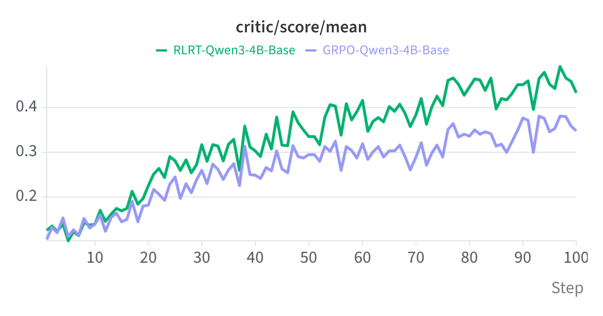

<div align="center">

# Self-Distillation for Single-Turn Reasoning

**An extension of [veRL](https://github.com/volcengine/verl) for post-training LLM reasoners with on-policy self-distillation and self-distilled RLVR.**

[](https://github.com/beanie00/self-distillation-analysis)
&nbsp;
[](https://github.com/beanie00/self-distillation-analysis/issues)
&nbsp;
[](https://github.com/beanie00/self-distillation-analysis/stargazers)

</div>

Self-distillation lets a single model act as both teacher and student by conditioning the teacher on richer context (e.g., ground-truth solutions), giving fine-grained credit assignment with a simple setup. In single-turn reasoning (like math), however, imitating the teacher's confident reasoning suppresses the student's own expression of uncertainty and degrades it ([COLM 2026](https://arxiv.org/abs/2603.24472)).

Our answer is **[RLRT](https://arxiv.org/abs/2605.10781)**, which reverses the teacher signal on correct rollouts so that the student's own reasoning is reinforced rather than overwritten. Beyond RLRT, this repository brings representative self-distillation methods together in one `verl`-based codebase — a shared base for studying how to use self-distillation well in single-turn reasoning.

## News

- [2026.10] 🔥 Unified release: `sdpo`, `srpo`, `rlsd`, and `rlrt` now live in a single codebase! See [Methods](#methods).
- [2026.09] *Rebellious Student: Reversing Teacher Signals for Reasoning Exploration with Self-Distilled RLVR* accepted at NeurIPS 2026! 🎉🎉🎉 (also **Oral** at the COLM 2026 ER Workshop, and the NeurIPS 2026 Pre-to-Post Workshop) [[Paper](https://arxiv.org/abs/2605.10781)] [[Project Page](https://beanie00.github.io/self-distillation-analysis/rlrt/)]
- [2026.07] *Why Does Self-Distillation (Sometimes) Degrade the Reasoning Capability of LLMs?* accepted at COLM 2026! 🎉🎉🎉 (also the COLM 2026 CBW Workshop) [[Paper](https://arxiv.org/abs/2603.24472)] [[Blog](https://beanie00.notion.site/why-does-self-distillation-degrade-reasoning)] [[Models](https://huggingface.co/collections/beanie00/self-distillation-analysis)] [[W&B](https://wandb.ai/beanie/SDPO-beanie/reports/Why-Does-Self-Distillation-Sometimes-Degrade-the-Reasoning-Capability-of-LLMs---VmlldzoxNjI1MTk5Mw?accessToken=i1ohtk0lbrcm63kkv1vd99f6jvb71sqoj32rgsokrs4l8r4vjz8q5mywtt8upwho)]
- [2026.03] Code released and paper on self-distillation degradation released.

## Methods

Each method is a `policy_loss.loss_mode` with its own config under `verl/trainer/config/`. All share a batch size of **256**, **8** rollouts per prompt, and a max response length of **20480**.

**On-policy self-distillation (OPSD)** — the teacher determines the update direction.

| `loss_mode` | Idea | Paper | Config |
|---|---|---|---|
| `sdpo` | Distillation loss against a teacher conditioned on the ground-truth solution. | [arXiv:2601.20802](https://arxiv.org/abs/2601.20802) | `sdpo.yaml` |
| `srpo` | Routes samples: distillation loss on incorrect rollouts, GRPO on correct ones, with entropy-aware dynamic weighting. | [arXiv:2604.02288](https://arxiv.org/abs/2604.02288) | `srpo.yaml` |

**Self-distilled RLVR** — the reward determines the update direction; the teacher only sets per-token magnitude.

| `loss_mode` | Idea | Paper | Config |
|---|---|---|---|
| `rlsd` | GRPO advantages reweighted per token by the teacher/student likelihood ratio $(P_T/P_S)^{\text{sign}(A)}$. | [arXiv:2604.03128](https://arxiv.org/abs/2604.03128) | `rlsd.yaml` |
| `rlrt` **(ours)** | Reverses that ratio on correct rollouts, reinforcing tokens the teacher would *not* have predicted. | [arXiv:2605.10781](https://arxiv.org/abs/2605.10781) | `rlrt.yaml` |

RLRT outperforms the GRPO baseline early in training, and the gap widens and persists throughout training.



## Installation

For environment setup, run `setup.sh` (tested on NVIDIA B200, CUDA 12.8):

```bash
bash setup.sh
source .venv/bin/activate
```

Set `WANDB_API_KEY` beforehand to log in. On other hardware, follow the [installation instructions in the SDPO README](https://github.com/lasgroup/SDPO/blob/main/README.md) instead.

### Data Preparation
We primarily use the [DAPO-Math-17k](https://huggingface.co/datasets/BytedTsinghua-SIA/DAPO-Math-17k) dataset for training. You can download it by running:
```bash
bash experiments/math/prepare_dapo_data.sh
```

The evaluation datasets are available in `data/math/evaluation`.

### Prompt Reformatting
The DAPO-Math-17k dataset prompts the model to produce answers in the `Answer:` format. The following script reformats these prompts to elicit `\boxed{}` answers instead. We found that this reformatting consistently improved the model's accuracy.
```bash
python experiments/math/change_math_prompts.py
```

<details>
<summary>See before/after example</summary>

**Before:**
```python
[{'content': 'Solve the following math problem step by step. The last line of your response should be of the form Answer: $Answer (without quotes) where $Answer is the answer to the problem.\n\nIn triangle $ABC$, $\\sin \\angle A = \\frac{4}{5}$ and $\\angle A < 90^\\circ$. Let $D$ be a point outside triangle $ABC$ such that $\\angle BAD = \\angle DAC$ and $\\angle BDC = 90^\\circ$. Suppose that $AD = 1$ and that $\\frac{BD}{CD} = \\frac{3}{2}$. If $AB + AC$ can be expressed in the form $\\frac{a\\sqrt{b}}{c}$ where $a, b, c$ are pairwise relatively prime integers, find $a + b + c$.\n\nRemember to put your answer on its own line after "Answer:".', 'role': 'user'}]
```
**After:**
```python
[{'content': 'In triangle $ABC$, $\\sin \\angle A = \\frac{4}{5}$ and $\\angle A < 90^\\circ$. Let $D$ be a point outside triangle $ABC$ such that $\\angle BAD = \\angle DAC$ and $\\angle BDC = 90^\\circ$. Suppose that $AD = 1$ and that $\\frac{BD}{CD} = \\frac{3}{2}$. If $AB + AC$ can be expressed in the form $\\frac{a\\sqrt{b}}{c}$ where $a, b, c$ are pairwise relatively prime integers, find $a + b + c$.\nPlease reason step by step, and put your final answer within \\boxed{}.', 'role': 'user'}]
```

</details>

## Run Examples

### Training
Before running training, you need to set up your environment variables:

1. Copy the sample environment file:
```bash
   cp ".env sample.local" .env.local
```
2. Open `.env.local` and fill in your configuration values.

Then launch any of the methods. Each script is named `run_math_<method>_<model>.sh`:

```bash
# GRPO baseline
bash experiments/math/run_math_grpo_deepseek_r1_distill_7b.sh   # DeepSeek-R1-Distill-Qwen-7B
bash experiments/math/run_math_grpo_qwen3_4b_base.sh            # Qwen3-4B-Base

# On-policy self-distillation
bash experiments/math/run_math_sdpo_deepseek_r1_distill_7b.sh   # DeepSeek-R1-Distill-Qwen-7B
bash experiments/math/run_math_srpo_qwen3_8b_base.sh            # Qwen3-8B-Base

# Self-distilled RLVR
bash experiments/math/run_math_rlsd_qwen3_4b_base.sh            # Qwen3-4B-Base
bash experiments/math/run_math_rlrt_qwen3_4b_base.sh            # Qwen3-4B-Base
bash experiments/math/run_math_rlrt_qwen3_8b_base.sh            # Qwen3-8B-Base
bash experiments/math/run_math_rlrt_qwen3_4b_instruct.sh        # Qwen3-4B-Instruct-2507
bash experiments/math/run_math_rlrt_qwen3_8b_nothink.sh         # Qwen3-8B, thinking off
```

Every script reads its settings from the environment first, so GPUs, ports, and hyperparameters can be changed without editing the file. `CUDA_VISIBLE_DEVICES` follows `NUM_GPUS` unless you set it explicitly:

```bash
NUM_GPUS=4 RAY_PORT=6500 bash experiments/math/run_math_rlrt_qwen3_4b_base.sh
```

Pass `--dry-run` to print the resolved command without launching anything.

All our training was conducted on B200 GPUs.

### Evaluation
After training, merge the saved FSDP checkpoints into HF format before running evaluation.
```bash
cd eval
bash merge_models.sh
bash eval.sh
```

<details>
<summary><b>Reproducing <i>Why Does Self-Distillation (Sometimes) Degrade the Reasoning Capability of LLMs?</i></b></summary>

**Released checkpoints.** Qwen3-8B (Thinking ON/OFF) and DeepSeek-Distill-7B are on
[🤗 Hugging Face](https://huggingface.co/collections/beanie00/self-distillation-analysis).
To evaluate them directly:

```bash
cd eval
bash eval_examples.sh
```

**Reasoning behavior under richer information.** How the model's reasoning changes when it is
given the solution as privileged context:

```bash
cd analyzing_reasoning_behavior

# Collect 100 questions from DAPO-Math-17k where the base model solves at a rate between 0.125 and 0.5, along with their solutions
bash eval_dapo_dataset.sh

# Re-evaluate the model with solutions provided as hints
bash eval_with_hint.sh

# Generate a summary report
bash make_report.sh
```

The collected results build the dataset for the SFT experiments:

```bash
bash make_sft_dataset.sh
```

**Task coverage.** The reduced question sets are in `data/math/section_6_2`. To train on them:

```bash
bash experiments/math/run_math_grpo_qwen3_8b_small_question.sh
bash experiments/math/run_math_sdpo_qwen3_8b_small_question.sh
```

</details>

## Citation
If you find this work helpful, please consider citing it:
```bibtex
@inproceedings{kim2026why,
  title={Why Does Self-Distillation (Sometimes) Degrade the Reasoning Capability of {LLM}s?},
  author={Jeonghye Kim and Xufang Luo and Minbeom Kim and Sangmook Lee and Dohyung Kim and Jiwon Jeon and Dongsheng Li and Yuqing Yang},
  booktitle={Third Conference on Language Modeling},
  year={2026},
  url={https://openreview.net/forum?id=Az7guis46K}
}

@inproceedings{kim2026rebellious,
  title={Rebellious Student: Reversing Teacher Signals for Reasoning Exploration with Self-Distilled RLVR},
  author={Jeonghye Kim and Jiwon Jeon and Dongsheng Li and Yuqing Yang},
  booktitle={The Fortieth Annual Conference on Neural Information Processing Systems},
  year={2026},
  url={https://arxiv.org/abs/2605.10781}
}
```

## Attribution
Our code is built upon [SDPO](https://github.com/lasgroup/SDPO), itself built on [veRL](https://github.com/volcengine/verl). We thank the authors of SDPO for their great research and for open-sourcing their codebase!

The `srpo` and `rlsd` loss modes are our reimplementations of [SRPO](https://arxiv.org/abs/2604.02288) and [RLSD](https://arxiv.org/abs/2604.03128) respectively.
